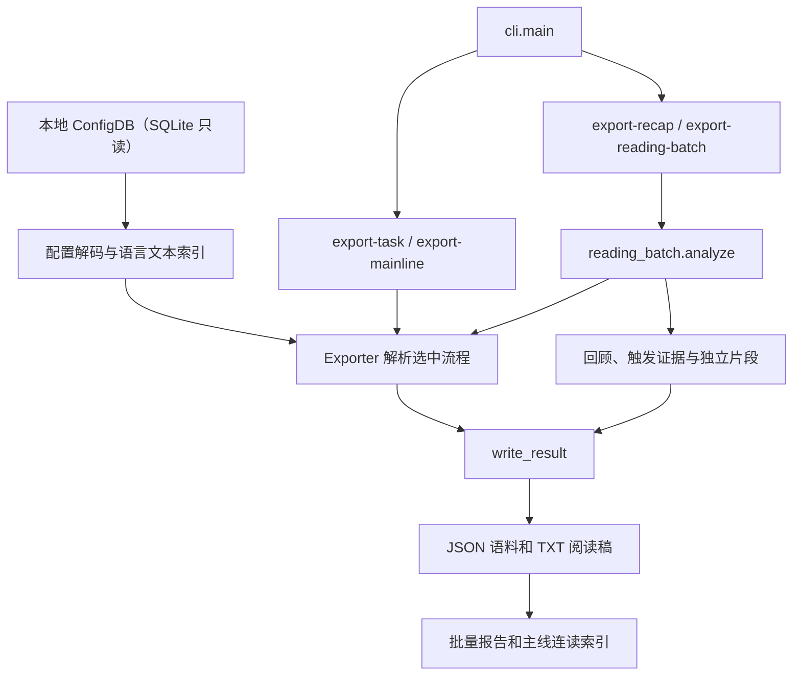

# 程序运行架构

## 命令走向

`python run.py`、`python -m wuwa_story` 和安装后的 `wuwa-story` 都调用 `cli.main`。CLI 按命令加载相应模块，因此帮助和参数校验可在无数据环境中运行。具体命令见[命令参考](commands.md)。

## 一次导出怎么运行

1. **读取配置。** `paths.py` 解析输入和输出目录，`database.py` 以 SQLite 只读模式打开 ConfigDB。解析器从 `BinData` 提取内嵌动作、任务和回顾记录，再解析中文文本与说话人。批次通过 `Snapshot` 复用已读取的行。
2. **评估任务路线。** `export_task.py` 的 `Exporter` 识别支持的任务结构、流程引用和选项。严格批次记录每个任务的首个失败原因。覆盖导出优先使用可取得的路线，必要时由 `recap_backbone.py` 按回顾条目逐段解析。
3. **核对顺序和来源。** `dependencies.py` 与 `task_flows.py` 记录同节点的调用和完成关系。实体、玩法和副本模块补充来源。`reading_cases/` 保存依赖特定任务配置的补位规则，按证据可用的阶段接入。无法定位的材料保留在 JSON。
4. **写出阅读稿。** `write_result` 保存完整 JSON。`mainline_reading.py` 选择 TXT 要展示的正文、选项和略过标记，并保存指回 JSON 原事件的路径。
5. **建立跨任务索引。** `chapter_reading_index.py` 在批量产物写出后，按任务前置、已核对的章节回顾和章节树组织阅读顺序。索引链接原有 TXT 和 JSON 文件。

## 源码位置

| 职责 | 主要模块 |
|---|---|
| CLI、目录与输入 | `cli.py`、`paths.py`、`database.py`、`batch.py` |
| 任务结构、流程和选项 | `export_task.py`、`coverage.py`、`variables.py`、`conditional_recap.py` |
| 回顾、依赖及归属 | `recap_backbone.py`、`chapter_recap.py`、`dependencies.py`、`declared_entity_content.py`、`declared_levelplay.py` |
| 特定任务的补位 | `reading_cases/`，其中 `continuations.py` 集中接入依赖回顾、任务、实体或玩法证据的补充对白 |
| 手机、资料和字幕 | `external.py`、`phone.py`、`letters.py`、`captions.py` 等 |
| 批量输出与阅读审查 | `reading_batch.py`、`mainline_reading.py`、`chapter_reading_index.py`、`reading_review.py` |

支持了哪些节点与选项，以及写入阅读稿时需要哪些证据，见[任务节点与对白选择](selection.md)。JSON 的字段及其保证范围见[语料格式](corpus-format.md)。
